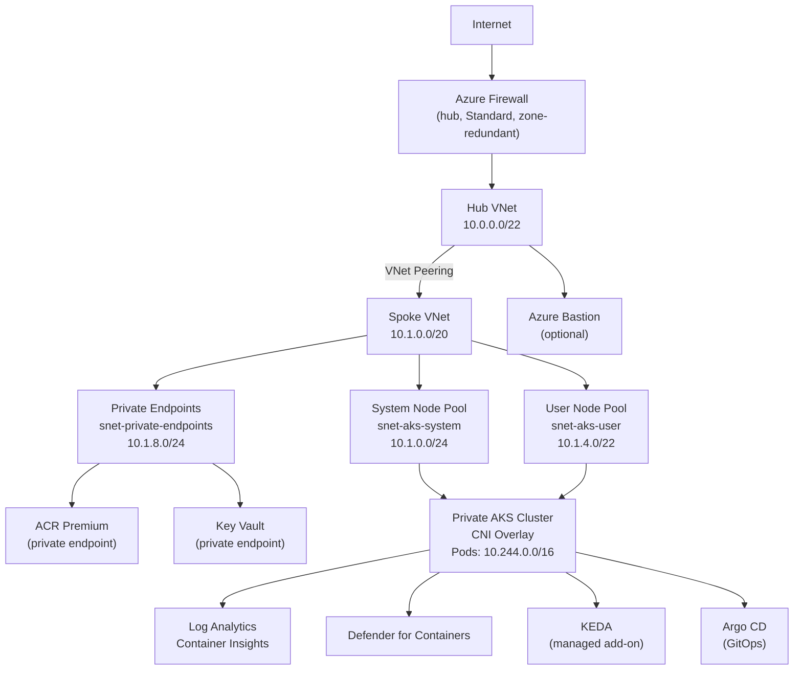

# Secure Private AKS Baseline (Terraform + AVM + Argo CD + KEDA)

A production-grade, HIPAA/HITRUST-aligned private AKS platform built with
Azure Verified Modules, hub-spoke networking, Azure Firewall UDR egress,
GitOps via Argo CD, and KEDA event-driven autoscaling.

## Architecture



## Security Controls

| Control | Implementation |
|---------|---------------|
| Private API server | `private_cluster_enabled = true`, no public FQDN |
| Entra ID + Azure RBAC | `enable_azure_rbac`, local accounts disabled |
| Workload Identity | OIDC issuer + Workload Identity add-on |
| Key Vault integration | CSI driver with secret auto-rotation |
| No public egress IPs | UDR to Azure Firewall (`outbound_type = "userDefinedRouting"`) |
| Container image security | ACR Premium, no admin user, AcrPull via managed identity |
| Secret storage | Key Vault private endpoint, RBAC auth, purge protection |
| Runtime security | Defender for Containers, Azure Policy add-on |
| State storage auth | `shared_access_key_enabled = false`; Entra ID auth only (`use_azuread_auth = true` in backend) |
| Host encryption | `enable_host_encryption = true` on both node pools |
| Minimal OS | AzureLinux on all nodes |

## Prerequisites

| Tool | Minimum Version |
|------|----------------|
| Terraform | 1.11.0 |
| Azure CLI | 2.60.0 |
| kubelogin | 0.1.0 |
| tflint | 0.50.0 |
| Checkov | 3.0.0 |

**Azure feature registrations required (one-time, per subscription):**

Both node pools use `enable_host_encryption = true`. The `EncryptionAtHost`
feature must be registered before you run `terraform apply`:

```bash
az feature register \
  --namespace Microsoft.Compute \
  --name EncryptionAtHost

# Wait for state == Registered (takes 2-5 minutes)
az feature show \
  --namespace Microsoft.Compute \
  --name EncryptionAtHost \
  --query "properties.state" -o tsv

# Propagate the registration
az provider register --namespace Microsoft.Compute
```

**Azure permissions required:**

The deploying identity (user or service principal) needs:
- `Owner` or `Contributor + User Access Administrator` on the subscription
  (to create resources and assign RBAC roles)
- `Storage Blob Data Contributor` on the state storage account (created by bootstrap)

## Step-by-Step Deploy

### 1. Bootstrap: create state storage

```bash
cd bootstrap
cp terraform.tfvars.example terraform.tfvars   # fill in subscription_id etc.
terraform init
terraform apply
# Copy the backend_config_snippet output value
```

### 2. Create backend config files

```bash
cp backends/platform.hcl.example backends/platform.hcl
# Edit platform.hcl with the values from step 1
```

### 3. Deploy platform infrastructure (Stage 1)

```bash
cd infra/platform
cp terraform.tfvars.example terraform.tfvars   # fill in all values
terraform init -backend-config=../../backends/platform.hcl
terraform validate
terraform plan -var-file=terraform.tfvars -out=tfplan
terraform apply tfplan
```

This creates: hub VNet, Azure Firewall, spoke VNet, private AKS cluster,
ACR, Key Vault, Log Analytics, route tables, private endpoints.

### 4. Install Argo CD (Stage 2)

`infra/platform` (Stage 1) runs on GitHub-hosted runners. The state storage
account allows public access by default (`state_storage_restrict_network_access
= false`), so no special network setup is required for plan and apply.

`infra/cluster-config` (Stage 2) installs Argo CD onto the private cluster and
requires connectivity to the private AKS API server. The machine running Stage 2
must have **bash** (Linux, macOS, or WSL), **Azure CLI** (`az`), and **kubelogin**:
the ACR image import step uses a bash `local-exec` provisioner, and the Kubernetes
and Helm providers authenticate to AKS via kubelogin. Run Stage 2 from a machine
with VNet connectivity (ExpressRoute, VPN, or Bastion jump box), or use
`az aks command invoke` for one-off commands from any machine with ARM API access.

Stage 2 must run from within the spoke VNet because the AKS API server is
private. Options:
- **`az aks command invoke`** for one-off commands (no VNet connectivity required)
- **Azure Bastion** + jump box inside the hub VNet
- **A machine with direct VNet connectivity** (VPN or ExpressRoute)

> **Private DNS zone for the AKS API server.** This baseline creates a
> Terraform-managed private DNS zone (`privatelink.<region>.azmk8s.io`) in
> the spoke resource group. The zone is linked to both the spoke VNet (node
> resolution) and the hub VNet (firewall / Bastion resolution). The AKS
> managed identity is granted *Private DNS Zone Contributor* on this zone so
> it can write the A record for the API server private endpoint. If you use
> an existing private DNS zone in a central hub subscription, replace
> `azurerm_private_dns_zone.aks_api.id` in `aks.tf` with the resource ID of
> that zone and adjust `rbac.tf` accordingly.

```bash
# From a machine with VNet connectivity:
az aks get-credentials \
  --resource-group $(terraform -chdir=infra/platform output -raw spoke_resource_group_name) \
  --name $(terraform -chdir=infra/platform output -raw aks_cluster_name)

cd infra/cluster-config
cp terraform.tfvars.example terraform.tfvars   # fill in values from stage 1 outputs
terraform init -backend-config=../../backends/cluster-config.hcl
terraform apply -var-file=terraform.tfvars
```

**Initial Argo CD credentials.** SSO is not configured in this baseline. Argo CD
generates an initial admin password in the `argocd-initial-admin-secret` Secret.
Retrieve it with:

```bash
kubectl -n argocd get secret argocd-initial-admin-secret \
  -o jsonpath="{.data.password}" | base64 -d
```

Change the password or configure an OIDC connector (Dex with Entra ID) before
exposing the UI beyond a port-forward.

### 5. Verify GitOps bootstrap

```bash
kubectl get applications -n argocd
```

## GitHub Actions Setup

1. Create a GitHub Environment named `production` with required reviewers.
2. Create a GitHub Environment named `production-plan` (no approval gate).
3. Configure OIDC federated credentials on your Azure App Registration for
   both environments.
4. Set repository variables (not secrets):
   - `AZURE_CLIENT_ID`
   - `AZURE_TENANT_ID`
   - `AZURE_SUBSCRIPTION_ID`
5. For local plan/apply, copy `backends/platform.hcl.example` to `backends/platform.hcl`
   and fill in the values from step 1. This file is gitignored; CI uses repository
   variables instead.

### CI vs deployment

| Workflow | Trigger | Needs Azure |
|---|---|---|
| `pr-plan.yml`: lint, validate, tflint, Checkov, Trivy | Pull request | No |
| `pr-plan.yml`: plan job | Pull request | Yes, skipped unless `AZURE_SUBSCRIPTION_ID` is set |
| `apply.yml` | Manual (`workflow_dispatch`) | Yes, skipped unless configured |
| `drift.yml` | Manual (`workflow_dispatch`) | Yes, skipped unless configured |

Lint and security scans run on every pull request without any cloud access. The plan, apply, and drift jobs are reference deployment workflows: they run only after you configure OIDC and the repository variables below. To run drift detection nightly in your own environment, add a `schedule` trigger to `drift.yml`.

All jobs run on `ubuntu-latest`. The state storage account allows public access by default so
GitHub-hosted runners can reach the backend without VNet connectivity.

**Required repository variables (Settings > Secrets and variables > Actions > Variables)**

| Variable | Description |
|----------|-------------|
| `AZURE_CLIENT_ID` | App Registration client ID for OIDC |
| `AZURE_TENANT_ID` | Entra ID tenant ID |
| `AZURE_SUBSCRIPTION_ID` | Target subscription ID |
| `TFSTATE_RESOURCE_GROUP` | Resource group of the state storage account |
| `TFSTATE_STORAGE_ACCOUNT` | Storage account name for remote state |
| `TFSTATE_CONTAINER` | Blob container name (bootstrap default: `tfstate`) |
| `TFSTATE_KEY` | State file key, e.g. `platform/terraform.tfstate` |
| `AKS_ADMIN_GROUP_OBJECT_IDS` | JSON array of Entra ID group object IDs for AKS cluster-admin, e.g. `["00000000-..."]` |
| `KV_ADMIN_OBJECT_IDS` | JSON array of Entra ID object IDs for the Key Vault Administrator role |

## Cost Warning

This baseline is not cheap. Estimated monthly cost in East US (as of late 2026):

| Resource | Approx Cost/Month |
|----------|--------------------|
| Azure Firewall Standard (zone-redundant) | ~$550 |
| AKS system node pool (3x D4ds_v5) | ~$450 |
| AKS user node pool (3x D8ds_v5, initial) | ~$900 |
| ACR Premium | ~$175 |
| Azure Bastion Standard | ~$270 |
| Log Analytics (90-day retention) | Variable |
| **Total (approximate)** | **~$2,350+/month** |

Scale down for dev/test by reducing node counts, disabling Bastion, and
using a smaller Firewall tier.

## Teardown

```bash
# Stage 2 first (removes in-cluster resources)
cd infra/cluster-config
terraform destroy -var-file=terraform.tfvars

# Then Stage 1
cd infra/platform
terraform destroy -var-file=terraform.tfvars

# Finally, bootstrap (destroys state storage; do this last)
cd bootstrap
terraform destroy -var-file=terraform.tfvars
```

> Key Vault has purge protection enabled with a 90-day retention window.
> After `terraform destroy`, the soft-deleted vault blocks recreating a vault
> with the same name for 90 days. Use `az keyvault purge` only if you are
> certain the data is no longer needed.

## Repository Layout

```
.
├── bootstrap/               Creates the remote state storage account (run once)
├── infra/
│   ├── platform/            Stage 1: networking, firewall, ACR, Key Vault, AKS
│   └── cluster-config/      Stage 2: Argo CD install and app-of-apps bootstrap
├── backends/                Backend .hcl files (fill from bootstrap output)
├── gitops/
│   ├── bootstrap/           Argo CD app-of-apps
│   └── apps/                Sample app + KEDA ScaledObject
├── .github/workflows/       pr-plan, apply, nightly drift detection
├── .tflint.hcl
├── .gitignore
└── docs/
    └── architecture.md      Design decisions and HIPAA control mapping
```

## Known Issues

**AVM Log Analytics workspace deprecation warning (cosmetic)**

When running `terraform validate` or `terraform plan` against `infra/platform`,
you will see:

```
Warning: Deprecated value used
  on .terraform/modules/log_analytics/outputs.tf line 16
  `local_authentication_disabled` has been deprecated in favour of
  `local_authentication_enabled` and will be removed in v5.0 of the AzureRM Provider
```

This warning originates inside `Azure/avm-res-operationalinsights-workspace` 0.5.1,
not in this codebase. It is cosmetic; functionality is unaffected and
`local_authentication_disabled = true` still works in AzureRM 4.x. When a new
module version removes the deprecated attribute, bump the pin in
`infra/platform/loganalytics.tf` and re-run `terraform init -upgrade`.

## Related Resources

- [Azure Kubernetes Service documentation](https://learn.microsoft.com/en-us/azure/aks/)
- [Azure Verified Modules](https://azure.github.io/Azure-Verified-Modules/)
- [AKS private cluster](https://learn.microsoft.com/en-us/azure/aks/private-cluster)
- [Azure CNI Overlay](https://learn.microsoft.com/en-us/azure/aks/azure-cni-overlay)
- [KEDA on AKS](https://learn.microsoft.com/en-us/azure/aks/keda-about)
- [Argo CD](https://argo-cd.readthedocs.io/)
